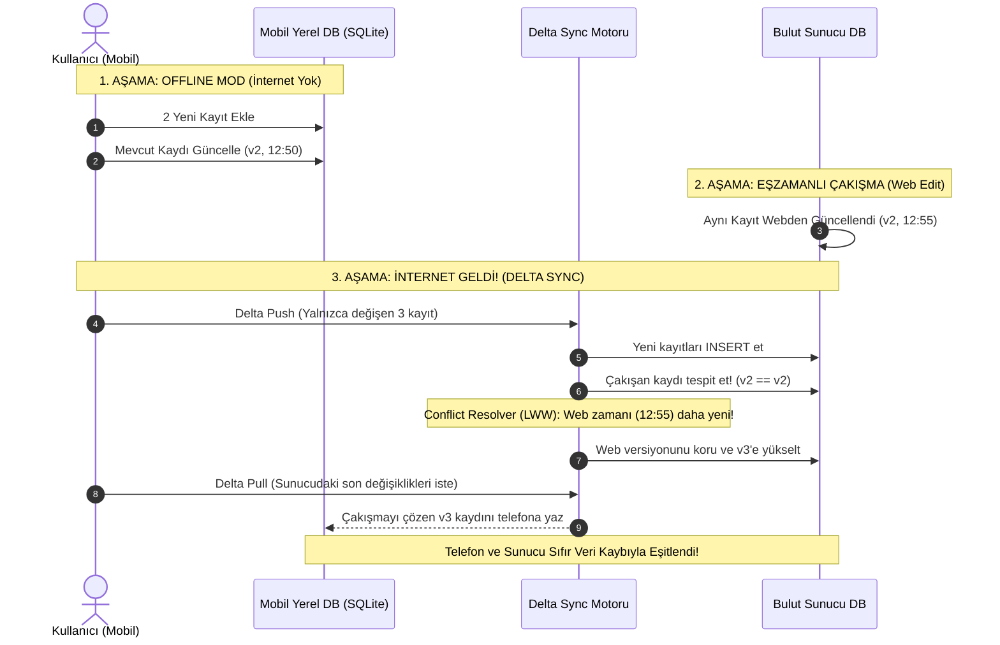

# Mobile Offline-First Sync & Conflict Resolution Engine in C# .NET


Bu repo; mobil uygulamaların (iOS / Android) **metro, uçak modu veya zayıf internet bağlantısı** gibi çevrimdışı (offline) ortamlarda kesintisiz çalışabilmesini ve internet geri geldiğinde bulut sunucusu ile sıfır veri kaybıyla senkronize olmasını sağlayan **Offline-First Delta Sync & Conflict Resolution** mimarisini simüle eden açık kaynak bir C# projesidir.

---

## 📌 Neden Offline-First & Delta Sync?

Mobil dünyada kullanıcılar her an internete bağlı kalamaz. Geleneksel sistemler internet olmadığında hata verirken, **Offline-First** mimari yerel veritabanına (SQLite / Room / CoreData) yazar.

İnternet geri geldiğinde ise iki kritik problem ortaya çıkar:
1. **Aşırı Veri ve Pil Tüketimi:** Her senkronizasyonda tüm veritabanını alıp vermek yerine yalnızca son eşitlemeden sonra değişen kayıtlar (**Delta Sync**) aktarılmalıdır.
2. **Eşzamanlı Çakışmalar (Data Conflicts):** Kullanıcı telefonda bir kaydı güncellerken, aynı anda web panelinden de aynı kayıt değiştirilirse hangi veri korunacaktır?

Bu motor bu iki problemi **endüstri standardı 3 prensip** ile çözer:
* **Delta Sync (Zaman Damgası Filtresi):** `UpdatedAtUtc > LastSyncTime` sorgusu ile minimum ağ trafiği.
* **Conflict Resolution (Çakışma Çözümü):** Sürüm kontrolü (`Version`) ve **Last-Write-Wins (LWW)** zaman damgası analizi.
* **Yumuşak Silme (Soft-Delete):** Silinen kayıtların diğer cihazlardan da silinebilmesi için `IsDeleted = true` bayrağı ile replikasyonu.

---

## 🔄 Mimari Akış Şeması (Mermaid Sequence Diagram)



---

## 🚀 Nasıl Çalıştırılır?

```bash
git clone https://github.com/EmreSlgr/mobile-offline-first-sync-engine.git
cd mobile-offline-first-sync-engine
dotnet run
```

### Beklenen Konsol Çıktısı

```text
==========================================================================
  MOBILE OFFLINE-FIRST SYNC & CONFLICT RESOLUTION (DELTA SYNC)
==========================================================================

>>> 1. ADIM: Başlangıç Durumu (Cihaz ve Sunucu Eşitlenmiş)
  [Eşitlendi] Ortak Kayıt: "Garajım: Periyodik Bakım" (Version: 1)

>>> 2. ADIM: Telefon İnternetten Koptu (Offline Mod) & Yerel Değişiklikler
  [Telefon (Offline)] 2 yeni not eklendi:
    + "Vaktin: Cuma Namazı Hatırlatıcısı"
    + "HCT: Aylık Harcama Özeti"
  [Telefon (Offline)] Mevcut not güncellendi (v2)

>>> 3. ADIM: Eşzamanlı Çakışma (Web Panelinden Aynı Kayıt Değiştirildi)
  [Sunucu (Web)] Aynı kayıt webden farklı güncellendi (v2)
  [DİKKAT] Çakışma (Conflict) Oluştu: Hem mobil hem sunucu v1'den v2'ye bağımsız güncellendi!

>>> 4. ADIM: İnternet Bağlandı! Delta Sync Motoru Devreye Giriyor...
  [Delta Push] Mobilden sunucuya sadece değişen 3 kayıt gönderiliyor...
    -> [ÇAKIŞMA ÇÖZÜLDÜ - Sunucu Kazandı] "Garajım: Periyodik Bakım" (Sunucu zamanı daha yeni)
    -> [Eklendi] Yeni kayıt sunucuya kaydedildi: "Vaktin: Cuma Namazı Hatırlatıcısı"
    -> [Eklendi] Yeni kayıt sunucuya kaydedildi: "HCT: Aylık Harcama Özeti"
  [Delta Pull] Sunucudan telefona değişen kayıtlar çekiliyor...
  [Başarılı] Senkronizasyon tamamlandı!

>>> 5. ADIM: Son Durum ve Veri Tutarlılığı Kontrolü
==========================================================================
  Telefondaki Toplam Kayıt: 3 | Sunucudaki Toplam Kayıt: 3
  SONUÇ: Sıfır veri kaybı. Çakışma Last-Write-Wins (LWW) ile çözüldü.
         Tüm veritabanı yerine yalnızca değişen birkaç byte veri aktarıldı!
```

---

## 📱 Gerçek Dünya Mobil Mimarilerinde Kullanım

Bu mantık; **Flutter, React Native, Swift (iOS) veya Kotlin (Android)** istemcileri ile **ASP.NET Core Web API** arasında şu protokol ile uygulanır:

1. **`POST /api/sync/push`:** İstemci, yerel SQLite tablosunda `is_synced = 0` olan değişmiş satırları gönderir.
2. **`GET /api/sync/pull?since={timestamp}`:** İstemci, sunucudan yalnızca son senkronizasyondan sonra güncellenen satırları talep eder.
3. Sunucu, dönen yanıtta yeni bir `SyncToken` üretir ve istemci yerel depolama biriminde bir sonraki istek için bu zamanı saklar.

---

## 👨‍💻 Geliştirici
* **Emre Salgır** - [GitHub Profilim](https://github.com/EmreSlgr) • [LinkedIn](https://www.linkedin.com/in/emre-salg%C4%B1r-a98b21174/)
